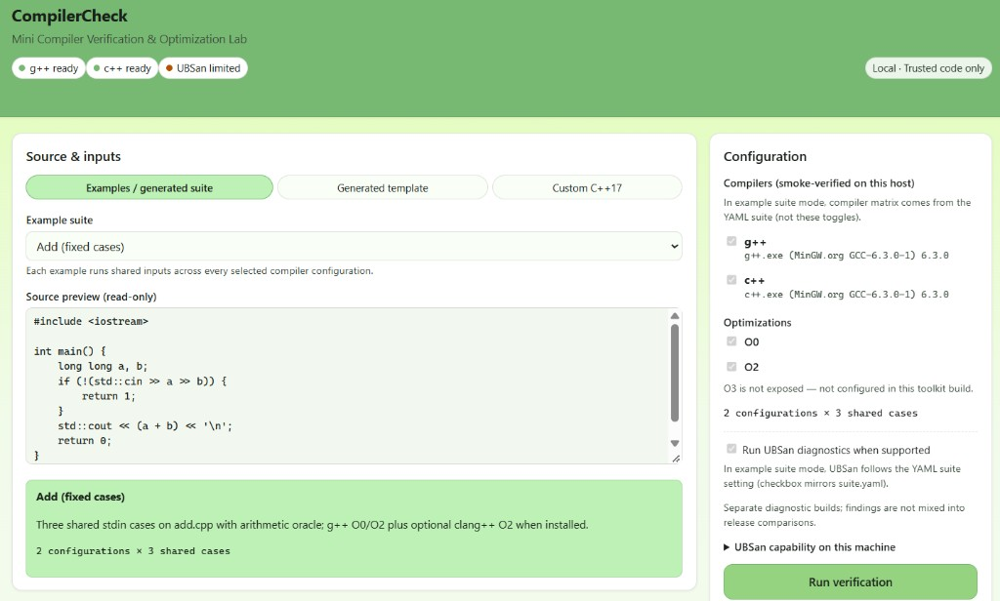
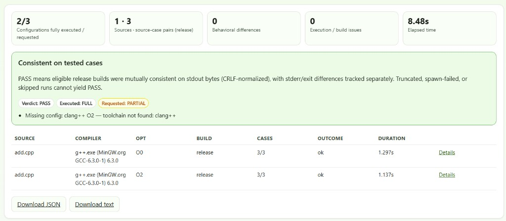
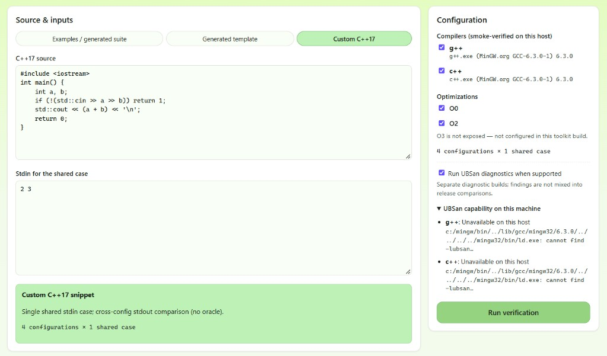

# CompilerCheck

Local C++17 verification prototype: compile each source once per compiler configuration, run shared stdin cases, compare stdout bytes (CRLF→LF only), optional Python oracles, and optional UBSan diagnostics. A Flask dashboard drives the same engine as the CLI. Intended for trusted local use and demos-not production deployment.

## Capabilities

- YAML suites with shared cases, generated inputs, and compile-failure examples
- Cross-configuration comparison plus oracles (`arithmetic_sum`, `sort_array`, `string_reverse`)
- JSON and text reports with reproduction snippets
- CLI and dashboard (example suites, generated templates, custom C++17 snippet)
- Timeouts and stdout/stderr size limits; suite-level deadline

## Screenshots

Overview (example suite and configuration):



Verification results (verdict, coverage, configuration table):



Custom snippet mode and UBSan capability details:



## Prerequisites

- Python 3.11+ (see `pyproject.toml`)
- At least one C++17-capable `g++` or `clang++` on PATH (smoke-tested at runtime)
- Optional: working UBSan link support on the host

## Installation

```powershell
git clone https://github.com/oomnii/Compiler-Check.git
cd CompilerCheck
python -m venv .venv
.\.venv\Scripts\Activate.ps1
python -m pip install -U pip
python -m pip install -e ".[dev,dashboard]"
```

## Run verification

Normal example (from repo root):

```powershell
python -m mctk.cli examples\suite.yaml --cache-dir .mctk_work --report reports\normal.json
```

Expected on a typical g++-only host: `interpretation.overall_verdict` **PASS**, executed coverage **FULL**, `requested_coverage` **PARTIAL** when optional `clang++` in the suite is missing.

Intentional compile failure:

```powershell
python -m mctk.cli examples\failure_suite.yaml --cache-dir .mctk_work_fail --report reports\failure.json
```

Expected: `interpretation.overall_verdict` **FAIL** with `compile_error` issues.

Dashboard:

```powershell
python -m mctk.dashboard --project-root . --port 8765
```

Open http://127.0.0.1:8765 - page title **CompilerCheck**. Example dropdown includes **Generated multi-program suite** (`examples/generated_suite.yaml`).

Optional source archive (writes ZIP next to the clone folder, not inside the repo):

```powershell
powershell -ExecutionPolicy Bypass -File scripts\create_publication_zip.ps1
```

## Tests

```powershell
python -m pytest -v
```

Five tests invoke a real host compiler when available; the rest use mocks or synthetic data.

## Verdicts and coverage

| Field | Meaning |
|-------|---------|
| **PASS** | Compared release runs that completed agree on normalized stdout; no blocking issues |
| **FAIL** | Compile/run failure, mismatch, oracle disagreement, truncation, etc. |
| **INCONCLUSIVE** | Not enough cross-config evidence or partial executed coverage |
| **`coverage`** | Executed - did fulfilled configs finish all shared cases? |
| **`requested_coverage`** | Requested - were optional or missing YAML toolchains left unfulfilled? |

Byte policy: only **CRLF → LF** before equality; lone CR is preserved.

## Limitations

- Optional toolchains in YAML may be absent on the host (`requested_coverage` **PARTIAL**).
- UBSan diagnostics require linker support; many MinGW installs cannot link `-lubsan`.
- Memory limit fields are reported as **NOT_ENFORCED**.
- Text exports summarize results; JSON is the full artifact.
- Dashboard binds to loopback with CSRF/Origin checks-run only on trusted local code.
- Subprocess behavior is exercised on the developer host but not guaranteed on every OS/load.

Python package name remains **`mctk`**; CLI entry points are unchanged (`python -m mctk.cli`, `python -m mctk.dashboard`).


Developed by **Om Seth** to automate C++17 compiler verification, compare program behavior across compiler configurations, and simplify debugging with reproducible reports.
